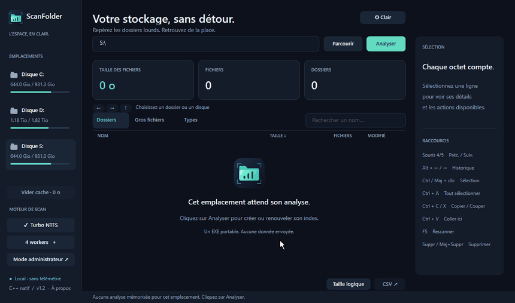

<p align="center">
  
</p>

<h1 align="center">ScanFolder</h1>

<p align="center">
  Trouver ce qui remplit le disque, et faire de la place.<br>
  Un seul exe natif pour Windows : rien a installer, aucun droit admin, aucune connexion.
</p>

<p align="center">
  
</p>

## Utilisation

1. Telecharger le zip de la derniere [release](../../releases/latest), le dezipper ou l'on veut et lancer `ScanFolder.exe` (Windows 10/11 x64).
2. Choisir un disque dans la barre laterale, saisir un chemin ou deposer un dossier, puis **Analyser**.
3. Parcourir les resultats :
   - **Dossiers** : sous-dossiers et fichiers tries par taille. Double-clic pour entrer, Retour pour remonter.
   - **Gros fichiers** : tous les fichiers du sous-arbre, du plus gros au plus petit.
   - **Types** : taille cumulee par extension. Double-clic pour voir les fichiers de ce type.
4. Selectionner une ou plusieurs lignes (Ctrl/Maj + clic) pour ouvrir dans l'Explorateur, copier, deplacer, compresser en ZIP ou supprimer.

Raccourcis utiles : **Ctrl+F** recherche, **Ctrl+L** chemin, **F5** relancer l'analyse, **Suppr** corbeille, **Maj+Suppr** suppression definitive, **Alt+Gauche/Droite** ou boutons lateraux de la souris pour l'historique.

## Points cles

- **Standalone** : un exe de quelques Mo, runtime C++ statique, interface Direct2D. Le moteur 7-Zip est embarque.
- **Hors ligne** : ni compte, ni telemetrie, ni mise a jour automatique.
- **Rapide** : parcours parallele (1 a 8 workers, 1 ou 2 conseilles sur HDD) ou lecture directe de la MFT NTFS en mode administrateur ("Turbo NTFS", lecture seule).
- **Cache par emplacement** : chaque disque ou dossier analyse garde un index compresse dans `%LOCALAPPDATA%\ScanFolder`. Revenir sur un disque recharge l'index sans rescanner ; **Analyser** ou F5 le renouvelle.
- **Suppression prudente** : confirmation systematique, `SUPPRIMER` a taper pour une suppression definitive, racines de volume, profils et Windows proteges. La corbeille n'a jamais de repli silencieux vers une suppression definitive.
- **ZIP verifie** : l'archive est testee (CRC) avant d'etre publiee a sa place, la source n'est jamais supprimee.

Un scan est un instantane : les changements faits ensuite par d'autres logiciels demandent une nouvelle analyse. Les jonctions et liens ne sont pas parcourus. Tous les details (cache, MFT, suppression, ZIP) sont dans le [guide](docs/GUIDE.md).

## Developpement

Visual Studio 2022 (ou Build Tools) avec les outils C++ x64, puis :

```powershell
.\build.cmd                                   # ScanFolder.exe a la racine
.\ScanFolder.exe --self-test rapport.txt      # tests integres (dossier unique dans %TEMP%)
.\ScanFolder.exe --scan "D:\dossier" rapport.csv --standard   # scan en ligne de commande
python tools\make_demo_gif.py                 # regenerer docs\demo.gif (Pillow)
```

`build.cmd` embarque `third_party/7zip` (7za.exe, licence et sources de 7-Zip 26.04, issus de la [release officielle](https://github.com/ip7z/7zip/releases/tag/26.04)). `SCANFOLDER_7ZA` permet d'utiliser un autre 7za.exe, `SCANFOLDER_CACHE_DIR` un autre dossier de cache. `ScanFolder.exe --third-party <dossier>` extrait le moteur 7-Zip, sa licence et ses sources. `tools\build-assets.ps1` regenere le logo PNG/ICO.

Publication (token lu dans Git Credential Manager) :

```powershell
python publish_github.py                                             # apercu, rien n'est envoye
python publish_github.py --push -m "message"                         # pousser les modifs
python publish_github.py --push -m "ScanFolder v0.2.0" --release v0.2.0   # + release avec l'exe
```

## Licence

[MIT](LICENSE). 7-Zip (embarque) est sous GNU LGPL 2.1 ou ulterieure, avec des parties BSD : voir [third_party/7zip/extra/License.txt](third_party/7zip/extra/License.txt).
